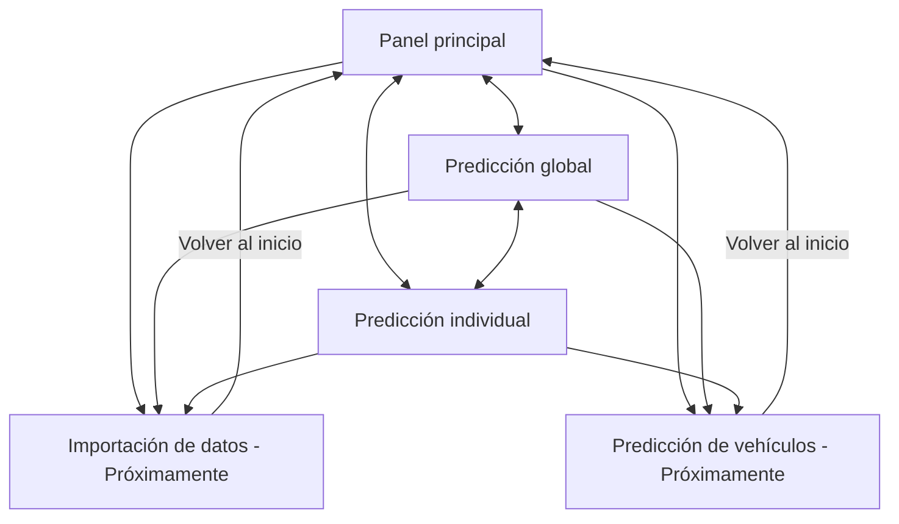
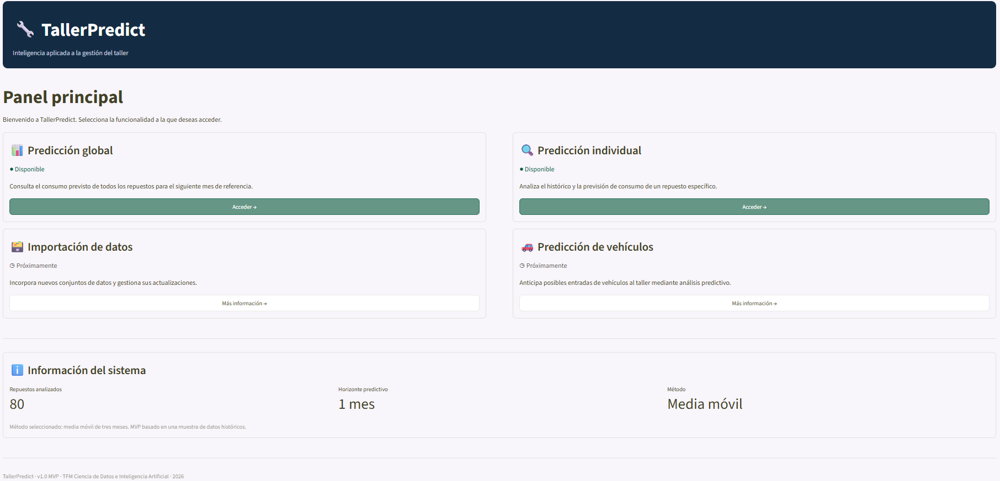
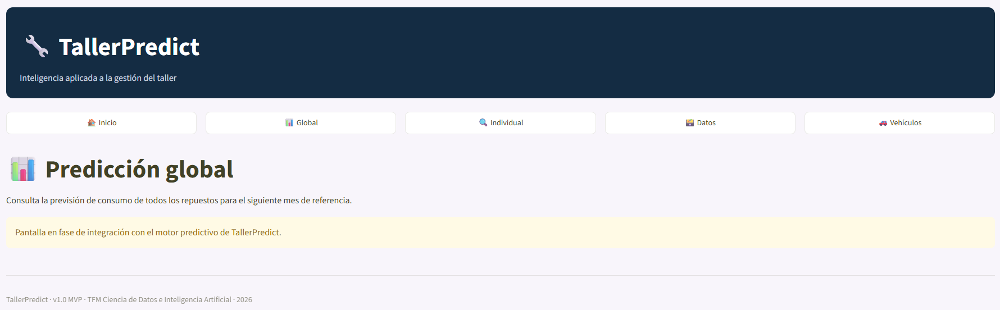
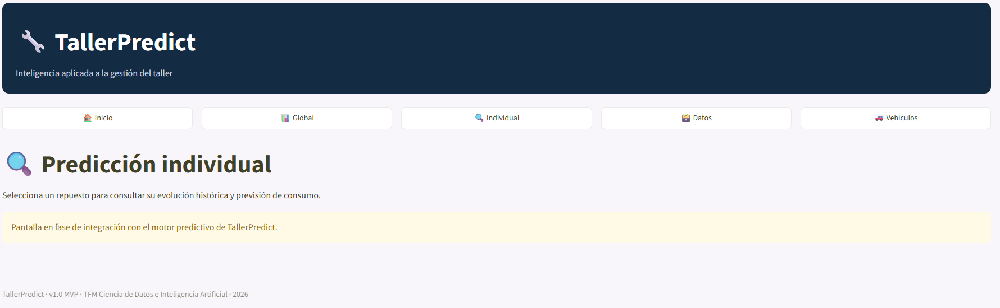
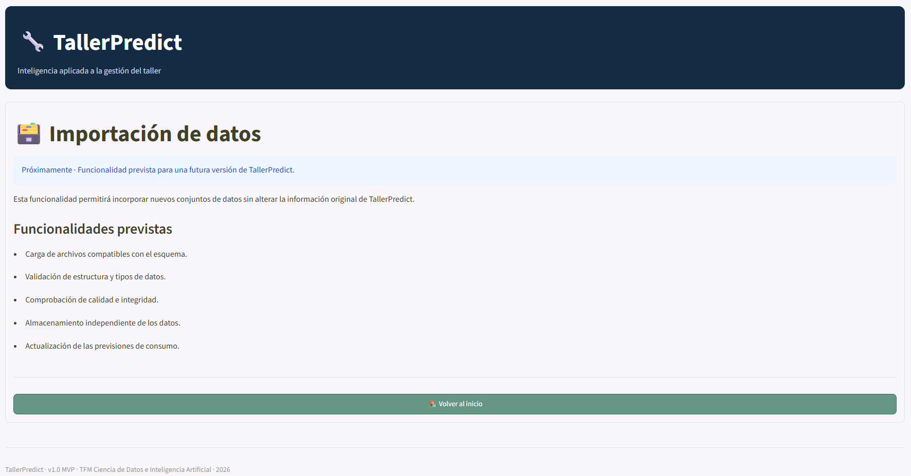
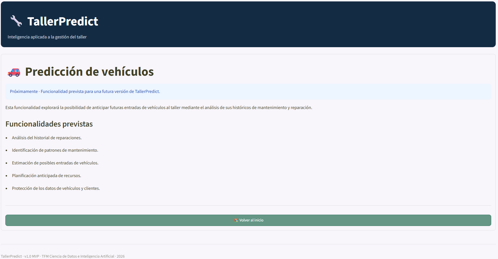
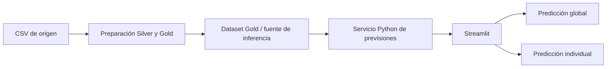

# Proyecto final — Entrega 04: Diseño del frontal y experiencia de usuario

**Producto:** TallerPredict  
**Proyecto:** TFM de Ciencia de Datos e Inteligencia Artificial  
**Estado:** diseño UX y primera versión navegable en Streamlit; integración predictiva pendiente.
**Documento anterior:** [`03_machine_learning.md`](03_machine_learning.md).  
**Ubicación en el repositorio:** `docs/entregas/04_diseno_frontal_ux.md`.

> **Resumen ejecutivo.** TallerPredict pretende facilitar la planificación mensual del consumo de repuestos de un taller mecánico. Se ha desarrollado un primer prototipo navegable con Streamlit que distingue dos consultas esenciales del MVP (predicción global e individual de repuestos) y dos funcionalidades futuras (importación de datos y predicción de vehículos). El diseño prioriza la claridad, la interpretación de las estimaciones y la facilidad de navegación. El motor previsto es la media móvil de tres meses, seleccionada en la Entrega 03 mediante validación temporal. La integración funcional se completará para la presentación final del 9 de diciembre de 2026.

## 1. Utilidad y valor del producto

### Usuario objetivo y problema

El usuario principal es el responsable del taller o del almacén, encargado de revisar las existencias y planificar las compras de repuestos. La solución pretende facilitar la anticipación del consumo mensual a partir de los registros de reparaciones, reduciendo la dependencia de decisiones basadas exclusivamente en la experiencia o en revisiones manuales del histórico.

El producto responde a la pregunta: **¿qué cantidad de cada repuesto se prevé consumir durante el siguiente mes respecto al último mes de referencia disponible?** La estimación se ofrece como apoyo a la decisión, no como una instrucción automática de compra.

### Funcionalidades esenciales

| Funcionalidad | Qué aporta | Decisión que facilita |
|---|---|---|
| Predicción global | Previsión mensual de los 80 repuestos de la muestra, con su unidad de medida. | Identificar piezas con consumo previsto y priorizar la revisión de existencias. |
| Predicción individual | Consulta de un repuesto concreto, su histórico y su estimación para el mes siguiente. | Examinar el comportamiento de una pieza antes de contrastar su previsión con el inventario. |

Ambas consultas utilizarán el mismo motor predictivo y la misma referencia temporal. La vista individual complementa la global: permite profundizar en un resultado sin generar una predicción metodológicamente diferente.

El usuario podrá contrastar las cantidades estimadas con las existencias reales y planificar una revisión de posibles necesidades. Para convertir estas estimaciones en recomendaciones de compra serían necesarios datos adicionales fiables, como stock disponible, pedidos pendientes, plazos de entrega, costes y niveles de seguridad. El MVP no automatizará pedidos ni garantizará que desaparezcan las roturas de stock.

La muestra utilizada procede de registros parciales cedidos por un taller mecánico. Se preservará la confidencialidad del establecimiento, clientes y vehículos conforme a las condiciones documentadas en la [Entrega 02](02_datos_y_preparacion.md). La interfaz de repuestos no necesita mostrar datos identificativos de clientes, vehículos u órdenes de reparación.

## 2. Flujo de usuario

### Acceso y navegación principal

Al iniciar la aplicación, el usuario encuentra un panel principal con cuatro tarjetas, cada una con un título, una descripción breve, un estado y un botón de acceso. El bloque inferior informa del número de repuestos de la muestra, el horizonte mensual y el método predictivo.

Las dos consultas de repuestos constituyen el alcance funcional previsto del MVP. Las otras dos tarjetas conducen a páginas informativas que explican las capacidades futuras, sin ejecutar operaciones sobre los datos.

### Recorrido de predicción global

1. El usuario accede a **Predicción global** desde el panel principal o desde el menú de una pantalla operativa.
2. La aplicación identifica el último mes de referencia válido de la fuente seleccionada y calcula el mes objetivo siguiente.
3. El servicio predictivo obtiene una estimación por repuesto utilizando los tres consumos mensuales conocidos al cierre del mes de referencia.
4. El usuario recibe una tabla con código, nombre, unidad y consumo previsto, acompañada del período de referencia y del mes objetivo. Se prevé incorporar búsqueda o filtrado y ordenación para facilitar la consulta.
5. El responsable puede revisar las piezas con consumo previsto positivo, contrastar los resultados con las existencias y acceder a la consulta individual o volver al inicio. La descarga CSV se contempla como mejora prioritaria si el plazo lo permite.

No se exige que el usuario introduzca manualmente las cantidades históricas ni que conozca el funcionamiento interno del modelo.

### Recorrido de predicción individual

1. El usuario accede a **Predicción individual** desde el inicio o el menú operativo.
2. Selecciona un repuesto mediante su nombre y/o código en un selector.
3. La aplicación presenta el mes objetivo, la cantidad estimada, su unidad y el histórico disponible hasta el mes de referencia.
4. Un gráfico permite interpretar la evolución del consumo y diferenciar las observaciones históricas de la previsión. También se mostrarán los tres valores utilizados en la media móvil para explicar el resultado.
5. El usuario puede seleccionar otro repuesto, cambiar a la vista global o volver al panel principal.

### Recorrido de funcionalidades futuras y retorno

Al seleccionar **Importación de datos** o **Predicción de vehículos**, se muestra una página específica con el aviso «Próximamente» y una explicación de las capacidades previstas. Estas páginas no contienen formularios activos, cálculos ni controles para modificar datos.

El único control de navegación visible en ellas es **Volver al inicio**. No se muestra el menú operativo. Esta decisión evita que una página informativa se confunda con una herramienta ya disponible y permite retomar la tarea desde un punto conocido.

La restricción se refiere a los controles de la interfaz, no al historial o a la navegación propia del navegador.

## 3. Diseño del frontal

### Herramienta seleccionada y estado del prototipo

Se ha elegido **Streamlit** para desarrollar una aplicación web en Python, aprovechando la preparación de datos y la experimentación ya realizadas en este lenguaje. La primera versión permite visualizar las cinco pantallas y sus controles de navegación. Las capturas siguientes corresponden a esa versión del 26 de noviembre de 2026; no muestran todavía resultados predictivos integrados.

### 3.1. Panel principal

*Figura 1. Captura real del panel principal del prototipo.*

El panel presenta una cabecera común con la identidad de TallerPredict y cuatro tarjetas distribuidas en dos columnas. Las consultas de repuestos aparecen en la primera fila, con botones de acceso destacados. Las funciones futuras ocupan la segunda fila y utilizan el botón «Más información». Los estados «Disponible» y «Próximamente» permiten distinguir el alcance previsto.

El bloque inferior muestra 80 repuestos, un horizonte de un mes y la media móvil como método. El valor de 80 corresponde a la muestra actual y deberá obtenerse dinámicamente en la versión integrada. En esta primera versión, «Disponible» identifica el acceso a las pantallas de consulta, no la ejecución de previsiones; para la presentación final deberá corresponder al funcionamiento efectivo de cada consulta.

### 3.2. Predicción global

*Figura 2. Captura real de la pantalla de predicción global.*

Actualmente presenta la cabecera, un menú de navegación, el título y un aviso de integración pendiente. La versión final incorporará los resultados calculados por el servicio predictivo.

**Diseño previsto de la presentación de resultados (esquema, no datos calculados):**

| Elemento de interfaz | Presentación prevista |
|---|---|
| Período | Mes de referencia y mes objetivo, explícitos. |
| Indicadores | Número de repuestos analizados y número con previsión positiva. |
| Controles | Búsqueda/filtrado por nombre o código y ordenación de la tabla. |
| Tabla | Código del repuesto, nombre, unidad y cantidad estimada para el mes objetivo. |
| Acción posterior | Consultar una pieza individual, volver al inicio y, si se implementa, exportar CSV. |

La tabla tendrá una fila por repuesto. Se conservará la unidad original (`ud`, `l`, `kg`, `kit` o `juego`) y no se sumarán cantidades físicamente heterogéneas en un indicador de consumo total. En caso de ordenar por cantidad, se interpretarán las cifras dentro de su unidad, sin equiparar litros con unidades de piezas.

### 3.3. Predicción individual

*Figura 3. Captura real de la pantalla de predicción individual.*

La estructura visual y el menú son comunes a la pantalla global. El aviso provisional será sustituido por el selector de repuestos y los resultados.

**Diseño previsto de la presentación de resultados (esquema, no datos calculados):**

| Elemento de interfaz | Presentación prevista |
|---|---|
| Selector | Nombre y código del repuesto. |
| Indicador principal | Consumo previsto, unidad y mes objetivo. |
| Gráfico temporal | Meses en el eje horizontal y consumo registrado en la unidad del repuesto en el eje vertical; estimación diferenciada visualmente. |
| Explicación | Tres consumos mensuales conocidos que intervienen en la media móvil. |
| Acción posterior | Seleccionar otra pieza, acceder a predicción global o regresar al inicio. |

Se distinguirán los valores observados de la estimación mediante etiquetas y una representación gráfica diferente. El histórico mostrado para explicar una predicción no incluirá observaciones posteriores a su fecha de referencia. Si se presenta posteriormente una comparación retrospectiva con el consumo real del mes objetivo, este se identificará como resultado observado, nunca como entrada del cálculo.

### 3.4. Importación de datos — Próximamente

*Figura 4. Captura real de la pantalla de importación de datos.*

La página explica la futura carga de archivos compatibles con el esquema de datos, la validación de estructura y tipos, la comprobación de calidad e integridad, el almacenamiento independiente y la actualización de previsiones. No permite realizar cargas en la primera versión. El objetivo futuro es incorporar una nueva muestra sin sobrescribir los datos existentes, mediante una base de datos independiente o un esquema aislado cuya estrategia se concretará en esa fase.

### 3.5. Predicción de vehículos — Próximamente

*Figura 5. Captura real de la pantalla de predicción de vehículos.*

La página describe una posible ampliación para analizar históricos de mantenimiento y reparación, identificar patrones y estimar futuras entradas de vehículos. Se trata de un problema predictivo diferente al consumo mensual de repuestos, que requerirá definir una variable objetivo, revisar la disponibilidad de datos, evaluar un modelo propio y garantizar la confidencialidad. No se ofrecen estimaciones de vehículos en el MVP.

## 4. Experiencia de usuario

### Justificación de la elección tecnológica

| Alternativa | Valoración para TallerPredict |
|---|---|
| **Streamlit (seleccionada)** | Integración directa con Python, pandas y la lógica predictiva existente; componentes de tablas, gráficos, selectores y navegación multipágina. Reduce el esfuerzo de integración antes del 9 de diciembre. |
| Power BI | Adecuado para informes e indicadores de negocio, pero menos directo para el flujo de aplicación y la reutilización de la lógica predictiva Python tal como se ha desarrollado. |
| Tableau | Potente para visualización y exploración de datos; la prioridad actual es una aplicación de consulta con navegación y servicios predictivos comunes, no un cuadro de mando analítico avanzado. |
| HTML + JavaScript | Mayor control del diseño visual; requeriría desarrollar y mantener una comunicación con la lógica Python, normalmente a través de un backend. |
| React | Adecuado para una futura interfaz web más compleja; implica una arquitectura frontend y backend adicional que aumenta el esfuerzo de implementación y pruebas del MVP. |

La elección responde a la adecuación al proyecto y al plazo, no a una inferioridad general de las otras herramientas.

### Claridad y facilidad de uso

La cabecera azul oscuro, el fondo claro y los botones de acción destacados crean una jerarquía visual común. Las tarjetas tienen títulos descriptivos, iconos de apoyo y etiquetas de estado; la distinción entre funciones disponibles y futuras no depende únicamente del color. Se mantiene la misma terminología en los menús, las tarjetas y los títulos.

Se priorizan las tareas de consulta frente a la cantidad de elementos visibles: la tabla es apropiada para comparar múltiples repuestos, mientras que el gráfico temporal permite examinar el comportamiento de una única pieza. Los controles deben ser comprensibles para un usuario no especializado en ciencia de datos. En la versión final se revisarán el contraste, la legibilidad, el funcionamiento de los botones y selectores y el comportamiento en distintos tamaños de ventana. No se afirma que ya se hayan realizado pruebas formales de usabilidad.

La navegación multipágina prevista utiliza el menú nativo de Streamlit oculto y controles propios de navegación. Las pantallas de consulta comparten un menú; las futuras ofrecen únicamente el retorno al inicio. Se evita utilizar un aviso de error para anunciar una funcionalidad planificada.

### Interpretación de las previsiones e incertidumbre

La aplicación informará de que la estimación procede de una media móvil de tres meses, que no es una garantía de consumo ni una recomendación de compra. Las cantidades decimales se mostrarán como estimaciones, respetando la unidad correspondiente, sin redondear automáticamente a cantidades de pedido.

El conjunto de datos es una muestra parcial y contiene numerosos meses sin consumo registrado. Una previsión igual a cero no demuestra ausencia de demanda real ni implica que la pieza deba dejar de almacenarse. Tampoco se presentará el error agregado del experimento como porcentaje de confianza de una predicción individual. En esta fase no se han estimado intervalos de predicción calibrados; por tanto, no se mostrarán bandas de confianza inventadas.

Se indicará el período histórico disponible y se evitará presentar una previsión retrospectiva como si correspondiera al mes natural actual. Las cifras se interpretarán dentro del contexto del histórico cedido.

### Gestión de errores y estados

| Situación | Comportamiento previsto |
|---|---|
| Archivo no disponible o lectura fallida | Mensaje comprensible, sin exponer información técnica sensible, y retorno al inicio. |
| Estructura incompatible o datos necesarios ausentes | No generar estimaciones incorrectas; indicar el problema y ofrecer retorno al inicio. |
| Repuesto sin tres meses válidos de contexto | Mostrar «Previsión no disponible» y distinguirlo de una previsión igual a cero. |
| Filtro sin coincidencias | Informar de que no hay resultados y permitir modificar o limpiar el filtro. |
| Previsión igual a cero | Mostrar el cero como resultado válido y explicar su interpretación. |
| Funcionalidad futura | Aviso informativo «Próximamente», explicación y botón exclusivo de retorno al inicio. |

Los estados «Próximamente» ya se observan en el prototipo. La gestión de errores de lectura, validación y cálculo se incorporará con la integración de los servicios.

## 5. Continuidad hacia el MVP final

### Conexión con las entregas anteriores

La [Entrega 02 — Datos y preparación](02_datos_y_preparacion.md) documenta la generación del dataset Gold a partir de siete CSV. El fichero utilizado en los experimentos es [`gold_consumo_mensual_repuestos.csv`](../../tallerpredict/datos/processed/gold_consumo_mensual_repuestos.csv), con 2.640 filas correspondientes a 80 repuestos y 33 meses de referencia (marzo de 2021 a noviembre de 2023).

La [Entrega 03 — Machine Learning](03_machine_learning.md) documenta la comparación de tres baselines, Ridge y Random Forest. Mediante cuatro ventanas de validación temporal se seleccionó la **media móvil de tres meses**. En la evaluación final reservada obtuvo un MAE escalado macro por repuesto de 0,501480, frente a 0,701927 para la referencia de predecir siempre cero, lo que supone una mejora del 28,56 %. Esta evidencia respalda su utilización como estimación orientativa en el MVP, pero no garantiza su rendimiento en períodos futuros ni en otros talleres.

El servicio predictivo utilizará los consumos conocidos al cierre del mes de referencia:

$$\widehat{y}_{t+1} = \frac{y_t + y_{t-1} + y_{t-2}}{3}$$

En el Gold, esos valores corresponden a `lag_1_units`, `lag_2_units` y `lag_3_units`; `rolling_3_units` contiene la media ya calculada. Se conservarán `part_id`, `part_code`, `part_name` y `unit` para identificar y presentar resultados. La variable `target_next_month_units` no será una entrada de la predicción.

Con el Gold actual, el último mes de referencia es noviembre de 2023 y su mes objetivo es diciembre de 2023. Como ese objetivo ya está observado en el conjunto histórico, se trata de una demostración retrospectiva, no de una previsión para diciembre de 2026 o enero de 2027. Una previsión posterior al último consumo observado (enero de 2024 respecto al histórico disponible) exigiría preparar una fila de inferencia específica con los tres últimos consumos conocidos, sin exigir una etiqueta futura. No se presupone que esa preparación esté implementada en la primera versión.

### Arquitectura de integración prevista

Se separarán la lectura y validación de datos, el cálculo y la presentación. Las dos pantallas utilizarán el mismo servicio Python para garantizar resultados consistentes. Se priorizará la lectura local del CSV Gold para asegurar la reproducibilidad de la demostración. PostgreSQL, cuyo esquema y carga se han trabajado previamente, podrá incorporarse como fuente de lectura si la integración se completa y verifica dentro del plazo; no será un requisito para arrancar la primera versión del frontal.

### Alcance para el 9 de diciembre de 2026

| Componente | Estado actual | Alcance de presentación final |
|---|---|---|
| Inicio y navegación multipágina | Primera versión visible en las capturas. | Mantener y verificar los recorridos. |
| Predicción global | Pantalla provisional. | Integrar cálculo, fechas, unidades, tabla y controles de consulta. |
| Predicción individual | Pantalla provisional. | Integrar selector, previsión, histórico y gráfico. |
| Importación de datos | Pantalla informativa. | Mantener «Próximamente» y retorno al inicio. |
| Predicción de vehículos | Pantalla informativa. | Mantener «Próximamente» y retorno al inicio. |
| Gestión de errores | Diseño definido. | Implementar y probar errores de datos y cálculo. |
| Exportación CSV / lectura PostgreSQL | Pendientes de integración. | Mejoras deseables, condicionadas a pruebas y plazo. |
| Carga de nuevos datos y modelo de vehículos | No implementados. | Fuera del alcance funcional del MVP. |

Antes de la presentación se comprobará que la aplicación arranca, que las dos vistas producen la misma estimación para una pieza y un mes determinados, que las unidades y fechas son correctas, que los errores se comunican sin confundirlos con ceros y que las páginas futuras solo muestran el retorno al inicio. Se actualizarán las capturas y las instrucciones de ejecución del README cuando la versión integrada esté lista. La revisión incluirá que no aparezcan datos privados ni identificadores de clientes o vehículos.

**Conclusión.** La primera versión del frontal transforma el trabajo de datos y experimentación en una propuesta de interacción concreta, comprensible y viable. El MVP se centrará en la previsión de consumo mensual de repuestos como apoyo a la planificación, manteniendo explícitamente fuera de alcance las funciones que requieren nuevas fuentes, modelos o procesos de importación.
